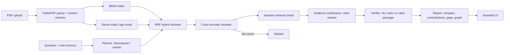

# Architecture

## Data & preprocessing
Papers: your uploaded PDFs (list in README). References sections are dropped; captions glued to table bodies;
hyphenation repaired; chunks ~900 chars within one section, with paper/section/page metadata.
Claim verification evaluated on SciFact (allenai/scifact). No test data used for tuning thresholds (tune on dev).
